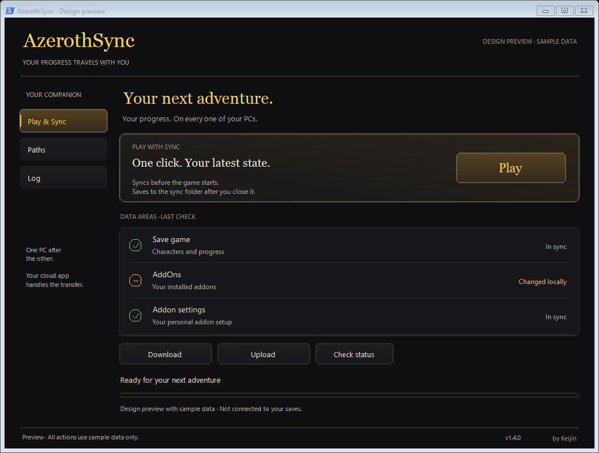

# AzerothSync

Play Azeroth Survivors on more than one Windows PC and keep your progress.
AzerothSync copies your save game, your AddOns and your addon settings through
a folder that your cloud drive (Google Drive, OneDrive, Dropbox, ...) already
keeps in sync between your computers.

> Unofficial fan tool. Not affiliated with the developers of Azeroth Survivors.



## What it does

* **Play** button (or desktop shortcut): downloads the newest state from the
  sync folder, starts the game, waits until you close it and uploads your
  progress.
* Syncs three areas separately:

  | Area | Local folder | In the sync folder |
  |---|---|---|
  | Save game | `%APPDATA%\wenilla-rogue` (without `language.txt`) | `data\save` |
  | AddOns | `<game config folder>\AddOns` | `data\addons` |
  | Addon settings | `<game config folder>\saved` | `data\saved` |

  The game config folder is the game's `benilla-config` folder, see
  [How paths are found](#how-paths-are-found).

* Backs up whatever it overwrites as a ZIP file, locally and in the cloud.
* Asks **one** question if both sides changed, never one per file or area.

It does **not merge** save games. The save files are encrypted, so one complete
state always wins. Do not play on two PCs at the same time.

## Requirements

* Windows 10 or 11 (uses .NET Framework 4, which is part of Windows)
* A cloud drive that shows up as a normal folder on every PC

## Setup

1. Download `AzerothSync.exe` from the [releases](../../releases) and put it
   **into your game folder**, next to `AzerothSurvivors.exe`. It then finds
   the game by itself.
2. Start `AzerothSync.exe`, open **Paths** on the left and check the four
   folders. Use `...` to change them:
   * **Game**: found automatically when AzerothSync sits in the game folder
   * **Sync folder**: choose a folder inside your cloud drive, for example
     `Google Drive\AzerothSync`
   * **Save game folder**: normally `%APPDATA%\wenilla-rogue`, filled in automatically
   * **Game config folder**: the `benilla-config` folder with `AddOns` and
     `saved`. Taken from the game folder if it is there, otherwise
     `C:\Git\wenilla\benilla-config` is suggested. Check it once.
3. Under **Play & Sync**, click **Upload** on the PC that has your current progress.
4. Under **Paths**, click **Desktop shortcut**. From now on start the game with
   *Azeroth Survivors (Sync)* on your desktop.
5. On every other PC: put `AzerothSync.exe` into the game folder there, choose
   the same sync folder, click **Desktop shortcut**, then play. The first time
   it will ask about a conflict, choose **Use cloud**.

Alternative: keep `AzerothSync.exe` inside the sync folder itself. Then the
sync folder is found automatically and you choose the game once.

Settings are stored per PC in `%LOCALAPPDATA%\AzerothSync\settings.ini`.

## How paths are found

| Path | How AzerothSync finds it |
|---|---|
| Game | `AzerothSurvivors.exe` next to `AzerothSync.exe` always wins. Otherwise the saved setting, otherwise `C:\Games\AzerothSurvivors\AzerothSurvivors.exe`. |
| Sync folder | The saved setting. If none is saved and `AzerothSync.exe` sits in a folder that already contains synced data (`manifest.json` or `data\`), that folder. Otherwise you choose it. |
| Save game folder | The saved setting, otherwise `%APPDATA%\wenilla-rogue`. |
| Game config folder | The saved setting if the folder exists. Otherwise `benilla-config` in the game folder, otherwise `C:\Git\wenilla\benilla-config`. If none of them exists, choose it, or AddOns and addon settings are skipped. |

Everything you change in the window is saved for this PC only.

## Buttons

| Button | What happens |
|---|---|
| Play | Download (asks only on a real conflict), start the game, upload after closing |
| Download | You want the cloud state: one confirmation, then everything that differs is replaced |
| Upload | You want your local state in the cloud: one confirmation, then everything that differs is replaced |
| Check status | Shows per area whether it is in sync, or which side is newer |
| Desktop shortcut (Paths) | Creates a shortcut that runs `AzerothSync.exe --play` |

The **Log** view shows the full technical log of the session. The look is
described in [docs/DESIGN.md](docs/DESIGN.md).

## How it decides

AzerothSync remembers a fingerprint (SHA256) of every area after each sync.
On the next sync it compares local, cloud and the remembered fingerprint:

* Only the cloud changed: download without asking.
* Only your PC changed: keep it, upload after playing.
* Both changed: one dialog for all affected areas: **Use cloud**, **Keep local** or **Cancel**.

Backups:

* Local backups before a download: `%LOCALAPPDATA%\AzerothSync\backups\` (last 20 per area)
* Cloud backups before an upload: `<sync folder>\history\` (last 10 per area)

To restore, delete the content of the matching folder (keep `language.txt`
in the save game folder) and unzip the backup into it, so no newer files
stay behind. After restoring a cloud backup into `data\<area>`, click
**Download** on each PC.

Safety: AzerothSync only takes a cloud state that matches the last upload
(a copy that is still syncing is left alone), copies into a temporary folder
and swaps it in only after checking it, and refuses overlapping or linked
folders. Details in [docs/HANDOVER.md](docs/HANDOVER.md).

## Antivirus and SmartScreen

AzerothSync is a small, new and unsigned program, which some scanners
distrust on principle. Being open about it:

* [VirusTotal scan of v1.1.1](https://www.virustotal.com/gui/file/5083a8826b6b44d80ab43fd6b9d6b6237f1765d99666e40c3f2ef41ccaa2c946):
  **2 of 70** scanners that analysed it flag it, **SecureAge APEX** ("Malicious") and **Trapmine**
  ("Suspicious.low.ml.score"). Both are verdicts from machine learning models,
  not a match for known malware. All other scanners, including Microsoft
  Defender, find nothing.
* Windows SmartScreen may show "Windows protected your PC" on the first start,
  because the exe has no code signature. Click **More info**, then **Run anyway**.

What the program does is fully visible in [`src/`](src): it reads and copies
files in the folders listed above, writes ZIP backups, starts the game and
creates a desktop shortcut on request. No network access of its own, no
installation, no administrator rights. If you prefer, build the exe yourself
from the source (see [Building](#building)).

## Troubleshooting

See [docs/HANDOVER.md](docs/HANDOVER.md) for technical details, error messages and fixes.

## Building

No IDE needed. The C# compiler of .NET Framework is part of Windows:

```
powershell -ExecutionPolicy Bypass -File build.ps1
```

Optional: `-DeployTo "<sync folder>"` copies the exe and the handover document there.

## License

MIT, see [LICENSE](LICENSE).
