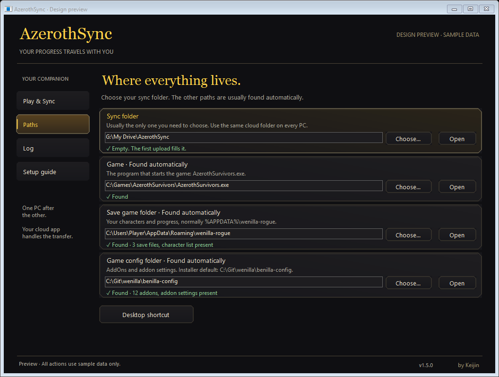
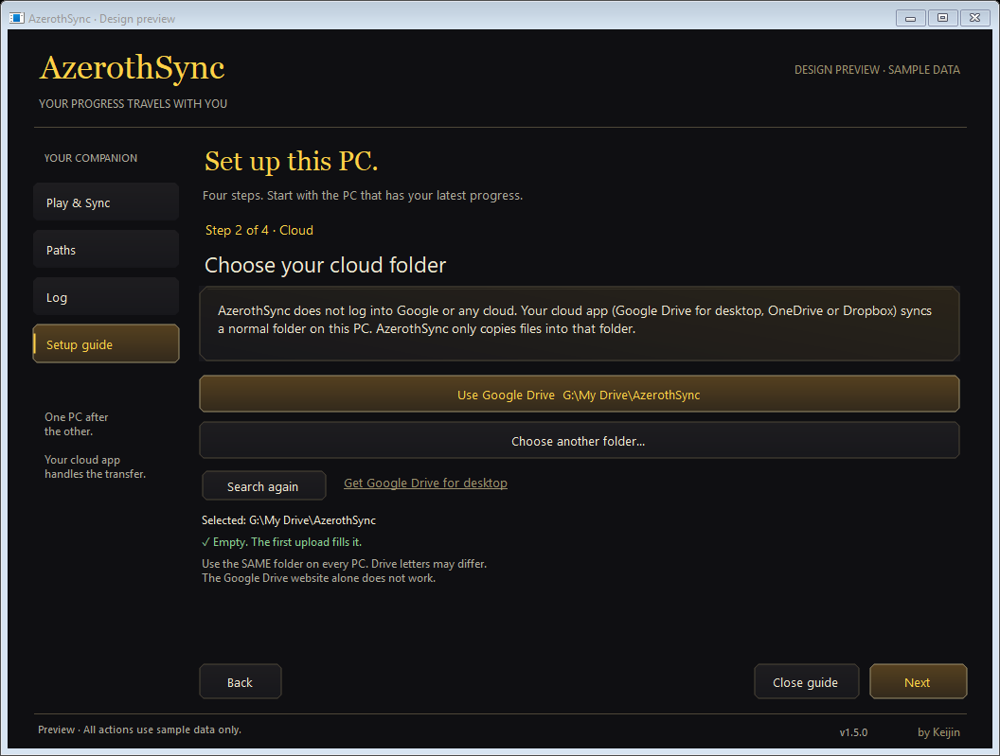
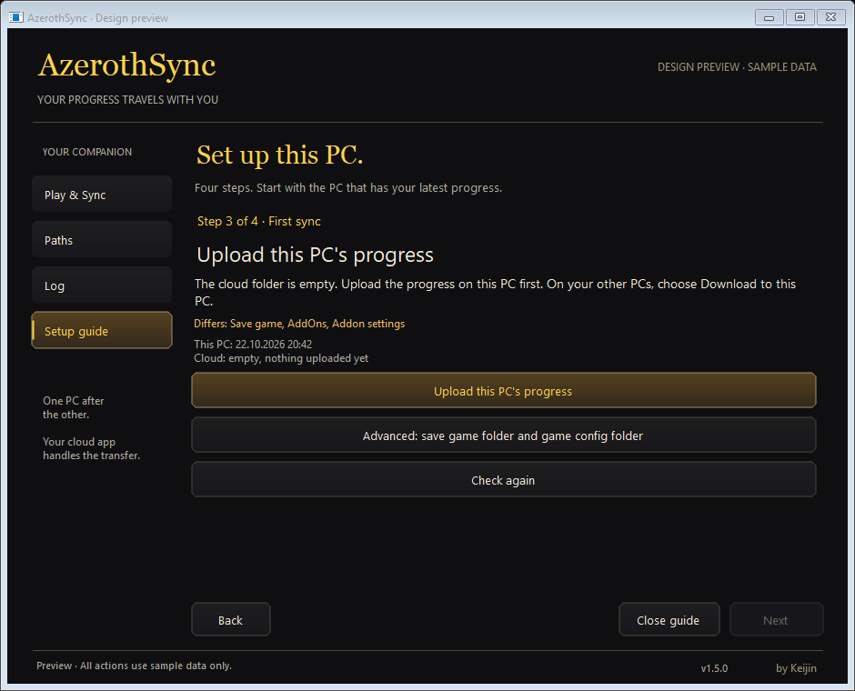
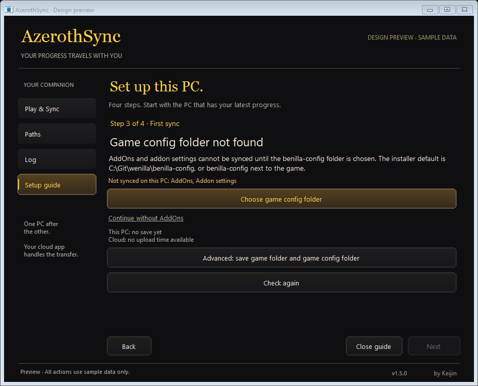

# AzerothSync look

Introduced in 1.4.0. Calm, almost black surfaces, warm text, thin bronze
outlines with cut corners and gold for the main action. Green is reserved for
confirmed data states, amber for changes and incomplete states. No game art,
WoW fonts or foreign textures are used; outlines and gradients are drawn in
code.

| Element | Value |
|---|---|
| Background | `#0F0F12` |
| Panels | `#17171B` / `#1E1D20` |
| Bronze outline | `#9E916E` |
| Headings | `#FFD147`, Georgia |
| Text | `#F0E8D1`, Segoe UI |
| Log | Consolas |
| Corners | 4 to 7 px cut |

## Views

**Play & Sync**: the Play button, the three data areas with the state of the
last check (text plus colour and shape, never colour alone), Download,
Upload, Check status and the progress. "In sync" means local and the reachable
sync folder match; it does not confirm that the cloud app already delivered
the data to the other PC.

**Paths**: the sync folder comes first with a bronze accent. Each row shows
its purpose, path, Choose and Open actions, and a check mark or cross with
the setup result and a correction hint. The other paths say Found automatically.
Long hints scroll at the unchanged minimum window size of 940 by 760. The whole
group is disabled while a sync runs.

**Log**: the unchanged technical log. Unknown engine messages are shown as
"See log" in the overview and never as success.

Dialogs (confirmations and conflicts) use the same surfaces. Enter and Escape
always mean Cancel or No.

## Files

| File | Purpose |
|---|---|
| `src/Theme.cs` | Palette, outlines, buttons, area rows, progress bar, dialogs, dark title bar |
| `src/Look.cs` | Layout of the three views, mapping of engine messages to area states, design preview |
| `src/App.cs` | Window logic and actions (unchanged sync behaviour) |
| `tests/LookTests.cs` | Preview writes nothing, pickers disabled during work, conservative states |
| `tests/DesignPreview.cs` | Entry point of the clickable design preview with sample data |

Build the preview with `build-preview.ps1`; it never loads or writes real
settings, never syncs and never starts the game. UI tests:
`tests\run-look-tests.ps1`.

The look was designed with Codex and adapted to English.

## Setup guide (1.5.0)

An in-window page keeps navigation and the existing theme. Step 1 of 4 through
Step 4 of 4, Back, Next and Close guide provide a clear route. Cloud setup uses
an explanation panel, detected folder buttons and visible validation. The
first sync step offers only the actions recommended by Setup.cs, with times
when available, differing areas and an explicit empty cloud description.
Advice is cached and checked in the background with the existing progress look.
Checking disables transfer actions and Next; Advanced keeps the cached result.
Advice fingerprints are checked again on click; changes require a fresh decision.
Missing config shows a direct picker, skipped areas and a secondary Continue
without AddOns link. Busy files show only Check again and keep Next disabled.
Footer keyboard order is Back, Close guide, Next.
Next allows continuing after a successful transfer with remaining differences
listed. Advanced save and config folders expand on request, with distinct
accessible picker names. Path checks wait for a 400 ms pause or leaving a field. Progress
appears above the navigation buttons; the guide is locked during work.

Both first sync references above use a 940 × 760 window.

Minimum size references: `design/paths-minimum.png` and
`design/wizard-cloud-minimum.png` and `design/wizard-first-sync-minimum.png`. Preview screenshots use sample data only.
