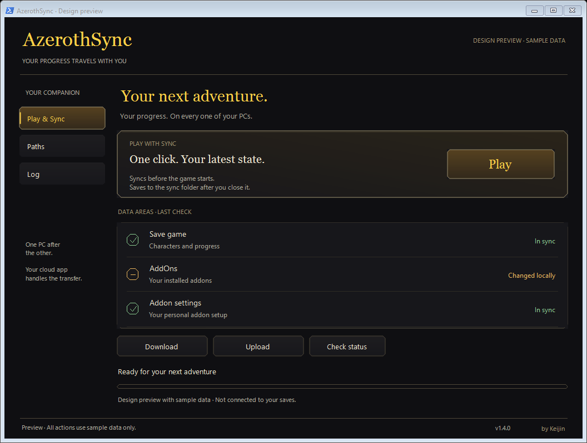

# AzerothSync look

Introduced in 1.4.0. Calm, almost black surfaces, warm text, thin bronze
outlines with cut corners and gold for the main action. Green is reserved for
confirmed data states, amber for changes and incomplete states. No game art,
WoW fonts or foreign textures are used; outlines and gradients are drawn in
code.

| Element | Value |
|---|---|
| Background | `#0F0F12` |
| Panels | `#17171B` / `#1E1D20` |
| Bronze outline | `#9E916E` |
| Headings | `#FFD147`, Georgia |
| Text | `#F0E8D1`, Segoe UI |
| Log | Consolas |
| Corners | 4 to 7 px cut |

## Views

**Play & Sync**: the Play button, the three data areas with the state of the
last check (text plus colour and shape, never colour alone), Download,
Upload, Check status and the progress. "In sync" means local and the reachable
sync folder match; it does not confirm that the cloud app already delivered
the data to the other PC.

**Paths**: the four folders of this PC and the desktop shortcut. The whole
group is disabled while a sync runs.

**Log**: the unchanged technical log. Unknown engine messages are shown as
"See log" in the overview and never as success.

Dialogs (confirmations and conflicts) use the same surfaces. Enter and Escape
always mean Cancel or No.

## Files

| File | Purpose |
|---|---|
| `src/Theme.cs` | Palette, outlines, buttons, area rows, progress bar, dialogs, dark title bar |
| `src/Look.cs` | Layout of the three views, mapping of engine messages to area states, design preview |
| `src/App.cs` | Window logic and actions (unchanged sync behaviour) |
| `tests/LookTests.cs` | Preview writes nothing, pickers disabled during work, conservative states |
| `tests/DesignPreview.cs` | Entry point of the clickable design preview with sample data |

Build the preview with `build-preview.ps1`; it never loads or writes real
settings, never syncs and never starts the game. UI tests:
`tests\run-look-tests.ps1`.

The look was designed with Codex and adapted to English.
